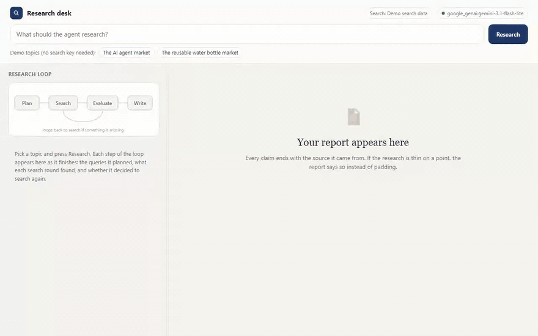

<h1>Research Report Agent</h1>

<b>Give it a topic. It searches, checks whether it really has enough, searches again if it doesn't, and then writes a report where every claim names its source.</b>

  
  
  
  
  
  

  <a href="#what-it-does">What it does</a> &nbsp;|&nbsp;
  <a href="#how-it-works">How it works</a> &nbsp;|&nbsp;
  <a href="#sample-run">Sample run</a> &nbsp;|&nbsp;
  <a href="#quick-start">Quick start</a> &nbsp;|&nbsp;
  <a href="#configuration">Configuration</a> &nbsp;|&nbsp;
  <a href="#roadmap">Roadmap</a>

 

<h2>See it in action</h2>

Recorded in the built-in research desk from a real run on Google Gemini (<code>gemini-3.1-flash-lite</code>) on 14 November 2026. Nothing is scripted. Only the time spent waiting for the model is fast-forwarded, and the real response times are shown on screen. <a href="demo/demo.mp4">Download the MP4</a>.

Run <code>python app.py</code> and it opens a research desk where you type a topic, watch each round of the loop and read the finished report with its sources. It is the same agent code as the command line version, with a screen on top.

<h2>The problem</h2>

Most AI research tools run one search, summarise the top few results and stop. The output reads well until someone who knows the subject notices what is missing.

Teams that need competitor analysis, market summaries or background research need something closer to how a person works: search, read, notice the gap, then go back for the specific missing piece. That is what this agent does.

<h2>What it does</h2>

<table>
  <tr><th align="left">Capability</th><th align="left">What that means in practice</th></tr>
  <tr><td><b>Plans its own searches</b></td><td>Turns a topic into a set of focused queries instead of one broad search.</td></tr>
  <tr><td><b>Checks its own work</b></td><td>After the first round the model reads its notes and decides whether something important is missing. If it is, it writes new, targeted queries and goes back.</td></tr>
  <tr><td><b>Bounded cost</b></td><td>Capped at two research rounds, so a curious agent can't run up an API bill.</td></tr>
  <tr><td><b>Cited report</b></td><td>Every claim in the final report carries its source in brackets, and thin areas are called out instead of padded.</td></tr>
  <tr><td><b>Honest fallback</b></td><td>Without a search key it covers two demo topics and says plainly that it has no data for anything else. It never invents sources.</td></tr>
  <tr><td><b>Saved output</b></td><td>The report prints in the terminal and saves as a markdown file in <code>output/</code>.</td></tr>
</table>

<h2>How it works</h2>

<pre>
plan --&gt; search --&gt; evaluate --+--&gt; gap found --&gt; back to search (max 2 rounds)
                               |
                               +--&gt; enough -----&gt; write cited report
</pre>

The graph is built with LangGraph. The evaluation step is a real conditional branch, not a fixed number of searches. Whether the agent does one round or two is a judgement it makes about its own notes.

Every decision point uses structured output through Pydantic, so the gap analysis and the follow-up queries come back as data the code can act on, not a paragraph to parse. Duplicate findings across rounds are filtered before the report is written.

<h2>Decisions I made on purpose</h2>

<h3>I didn't fake the demo data</h3>

I could have generated plausible search results for any topic, so the demo would work on anything. I decided against it. A research tool that invents sources when it can't find real ones is exactly the failure this project exists to prevent, so the offline demo covers two topics properly and refuses the rest.

<h3>Reports that admit gaps</h3>

The writing prompt tells the model to say so when the notes are thin, instead of filling the section with generic sentences. A report that says the sources don't cover pricing is more useful than two vague lines that look like an answer.

<h2>Sample run</h2>

A real run on Google Gemini, using the offline demo data (shortened):

<pre>
$ python research.py "the AI agent market"
Researching: the AI agent market
Ran 2 search round(s), 5 queries, 4 findings gathered.

# Research Report: The AI Agent Market

## Summary
Demand for AI agent development has grown strongly through 2025 and into 2026
as businesses shift from basic chat tools to operational automation
(industry-report-2026.com). Adoption favours narrow, specialised agents over
broad general-purpose assistants due to reliability concerns
(tech-trends-quarterly.com) ...

## Data Limitations
The available data gives useful qualitative insight into tool adoption and
popular project types, but it lacks quantitative metrics such as total market
size or revenue projections.

Saved to output/report_the_AI_agent_market.md
</pre>

<h2>Quick start</h2>

You need Python 3.12 or newer and an API key from OpenAI, Anthropic or Google Gemini.

<pre>
pip install -r requirements.txt
cp .env.example .env        # on Windows: copy .env.example .env
# open .env and paste your API key
python app.py               # opens the research desk at http://localhost:8000
python research.py "the AI agent market"
</pre>

Two topics work offline: <code>"the AI agent market"</code> and <code>"the reusable water bottle market"</code>. Add a Tavily key to research any topic on the live web.

<h2>Configuration</h2>

Everything is set in <code>.env</code>. Copy <code>.env.example</code> to start.

<table>
  <tr><th align="left">Variable</th><th align="left">Required</th><th align="left">Purpose</th></tr>
  <tr><td><code>LLM_MODEL</code></td><td>Yes</td><td>Which model to use, as <code>provider:model</code>. Default <code>openai:gpt-5.5</code>. Also works with <code>anthropic:claude-opus-5-5</code> or <code>google_genai:gemini-3.5-flash</code>.</td></tr>
  <tr><td><code>OPENAI_API_KEY / ANTHROPIC_API_KEY / GOOGLE_API_KEY</code></td><td>One of them</td><td>The key for whichever provider you picked.</td></tr>
  <tr><td><code>TAVILY_API_KEY</code></td><td>No</td><td>Turns on live web search. Without it the agent uses the offline demo data.</td></tr>
</table>

<h2>Project structure</h2>

<pre>
ai-research-report-agent/
  .env.example          # copy to .env and add your key
  case_study.md         # longer write-up of the design
  README.md
  requirements.txt      # dependencies
  research.py           # command line entry point
  app.py              # browser research desk, the same agent with a UI
  agent/
    llm.py              # picks the model from LLM_MODEL
    researcher.py       # the LangGraph graph: plan, search, evaluate, write
    search.py           # Tavily search with the offline fallback
  data/
    sample_research/    # offline research data for the two demo topics
  demo/                 # recording of a live run (GIF, MP4 and a screenshot)
  tests/                # pytest suite, runs without any API key
  web/
    index.html          # the research desk, one file, no build step
</pre>

<h2>Built with</h2>

Python &nbsp;&middot;&nbsp; LangGraph &nbsp;&middot;&nbsp; LangChain &nbsp;&middot;&nbsp; Pydantic &nbsp;&middot;&nbsp; Tavily &nbsp;&middot;&nbsp; OpenAI / Anthropic / Gemini

<h2>Tests</h2>

<pre>
pip install -r requirements-dev.txt
pytest
</pre>

Eight tests cover the demo search data, the duplicate-finding filter, the round cap and the routing between searching and writing, plus the browser screen and its API. None of the tests call a model or need an API key, so they run on GitHub Actions on every push. The badge at the top shows the latest result.

<h2>Roadmap</h2>

What I would build next if a client took this into production:

<ul>
  <li>A configurable round limit with a cost cap behind it</li>
  <li>Export to PDF or Google Docs, which is the format most clients actually want</li>
  <li>Follow-up questions against research the agent has already done, instead of starting over</li>
  <li>Scheduled reports, for example a weekly competitor summary delivered to Slack or email</li>
</ul>

<h2>More from this series</h2>

Nine production-minded AI agents, each solving one business problem properly.

<table>
  <tr><td><a href="https://github.com/saqib-n/ai-sales-outreach-agent"><b>AI Sales Outreach Agent</b></a></td><td>Personalised cold emails and follow-ups, with a human approving every send.</td></tr>
  <tr><td><a href="https://github.com/saqib-n/ecommerce-automation-agent"><b>E-commerce Order and Inventory Agent</b></a></td><td>Shopify order, stock and returns assistant, plus a monitor that warns you before stock runs out.</td></tr>
  <tr><td><a href="https://github.com/saqib-n/email-triage-agent"><b>Email Triage Agent</b></a></td><td>Sorts an inbox into four buckets and gives each one a different level of autonomy.</td></tr>
  <tr><td><a href="https://github.com/saqib-n/lead-qualification-crm-agent"><b>Lead Qualification Agent</b></a></td><td>Scores inbound leads against your own rubric and pushes the good ones to HubSpot.</td></tr>
  <tr><td><a href="https://github.com/saqib-n/multi-agent-customer-support"><b>Multi-Agent Customer Support</b></a></td><td>A router plus specialist agents for orders, refunds, FAQs and human handoff.</td></tr>
  <tr><td><a href="https://github.com/saqib-n/rag-knowledge-base-agent"><b>RAG Knowledge Base Agent</b></a></td><td>Answers questions from your own documents and names the source for every answer.</td></tr>
  <tr><td><a href="https://github.com/saqib-n/recruiting-screening-agent"><b>Resume Screening Agent</b></a></td><td>Ranks resumes against a job description with evidence, and guards against common bias.</td></tr>
  <tr><td><a href="https://github.com/saqib-n/whatsapp-support-agent"><b>WhatsApp Support Agent</b></a></td><td>A WhatsApp Cloud API agent that checks orders, answers FAQs and escalates to a person.</td></tr>
</table>

<h2>Work with me</h2>

I'm Saqib Nawaz, founder of WolfXense AI. I build AI agents and automations for businesses, with Python, LangChain, LangGraph and n8n, and connect them to the tools teams already use, like CRMs, Shopify, Slack, email and WhatsApp.

If your team spends hours pulling together market or competitor research, I can adapt this agent to your sources, your report format and your delivery channel.

<a href="https://www.upwork.com/freelancers/~01de008504a38baf28"><b>Hire me on Upwork</b></a> &nbsp;|&nbsp; <a href="https://github.com/saqib-n"><b>More of my work on GitHub</b></a>

Released under the <a href="LICENSE">MIT License</a>. A longer write-up of the design is in <a href="case_study.md">case_study.md</a>.

